Full-stack & AI engineer, studying at RUPP in Phnom Penh. I build web and mobile apps, and tools that run LLMs and speech models locally.

### Now building

| | Project | What it is | Stack |
|---|---|---|---|
| 01 | **Clip Studio** | Turns long YouTube videos into Shorts, fully local | Python · Ollama · Whisper |
| 02 | **Serey** | Music platform — web and iOS app | Next.js · Flutter |
| 03 | [**SEREY-chatbot**](https://github.com/TeHenglay/SEREY-chatbot) | AI assistant for Serey | Python |
| 04 | [**ollama-chat**](https://github.com/TeHenglay/ollama-chat) | Chat UI for a local Ollama model | React |
| 05 | [**Riftbound**](https://github.com/TeHenglay/Riftbound) | Roblox game with Blender-made levels | Lua · Blender |

### Stack

### Contact

[tehenglay098@gmail.com](mailto:tehenglay098@gmail.com) · [Portfolio](https://tehenglay.laszlo.icu/)

<picture>
  <source media="(prefers-color-scheme: dark)" srcset="https://raw.githubusercontent.com/TeHenglay/TeHenglay/output/github-snake-dark.svg" />
  
</picture>
